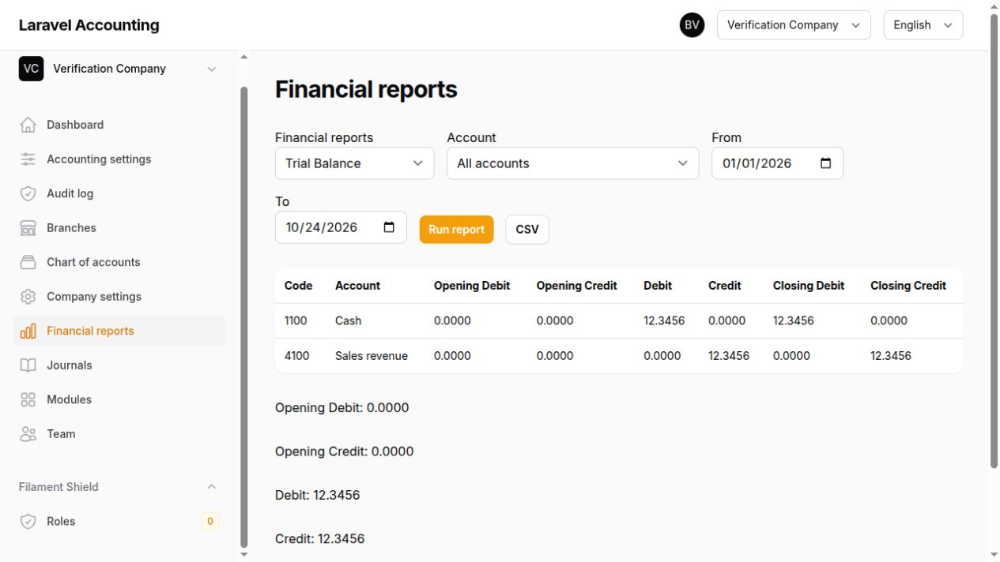
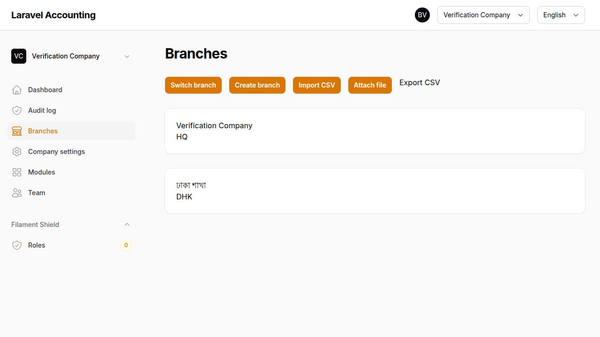
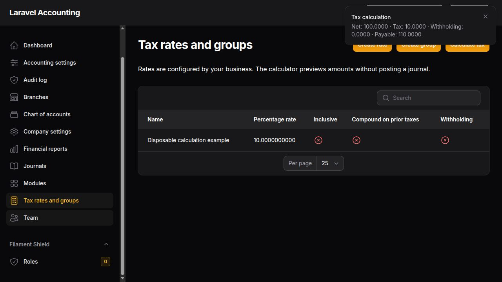

<div align="center">

# Laravel Accounting

### Less spreadsheet chasing. More clarity across your business.

An extensible accounting and business platform built with **Laravel 12 · Filament 3 · Livewire**.

**Multiple companies · Branch-aware access · Exact accounting · English & বাংলা**


[Explore the application](#-see-the-application) · [Available features](#-what-you-can-use-today) · [Business opportunities](#-the-24-module-platform) · [Get started](#-get-started) · [Connect](#-lets-connect--collaborate)

</div>

---

Bring company administration, branch access, journals, approvals, tax calculations, supporting documents, and financial reporting into one workspace. Start with the accounting foundation and follow the roadmap toward connected sales, stock, payments, people, production, and intelligence.

> **Project status:** The tenant platform, initial ledger/report workflows, tax foundation, and voucher attachments are implemented. The complete business platform is still being built. The 24 registered module manifests describe the architecture; they are **not 24 finished business applications**. This checkout is for development and evaluation, and has not been signed off for production bookkeeping. See [delivery progress](docs/PROGRESS.md) for the current boundary.

## 📸 See the application

These are real application screenshots captured during local browser verification. They show disposable example data, not customer records. The branch screenshot is from an earlier core checkpoint; navigation expands as features are added.

### Financial visibility without rebuilding a spreadsheet

Run a trial balance with opening balances, period movements, and closing balances. Review exact amounts on screen and download CSV for further analysis.



### One workspace for your companies and branches

Switch between authorized branches, manage branch records, import or export branch data, and choose English or Bangla from the application interface.



### Configurable tax calculations with visible results

Create rates and ordered groups, choose line or document rounding, and preview net, tax, withholding, and payable amounts before using the calculation in a business workflow.



## 💡 Why this matters for your business

| Business challenge | Available capability | Practical opportunity |
| --- | --- | --- |
| Separate files for each company or branch | Company context, branch switching, and explicit access rules | Keep work organized while giving staff access to their assigned branches. |
| Rebuilding the same financial summaries | Reports read posted journals and balance snapshots | Spend more time reviewing results and less time assembling report sheets. |
| Accidental changes to historical entries | Posted journal guards, linked reversals, and period locks | Correct mistakes through a visible accounting trail. |
| One person creating and approving an entry | Independent maker/checker approval with a company threshold | Separate preparation and approval responsibilities. |
| Searching for voucher evidence | Private scanned attachments linked to vouchers | Keep supporting evidence beside the accounting record. |
| Repeating tax arithmetic | Ordered tax groups, inclusive/compound calculations, withholding, and rounding settings | Reuse a consistent calculation method. |
| Moving branch lists by hand | Queued branch CSV imports with row errors and CSV exports | Reduce repetitive branch master-data entry. |
| Unclear responsibility for changes | Audit events, actor attribution, and integrity verification | Investigate who changed what with better context. |
| Mixed-language teams | English/Bangla interface labels and localized account names | Make the workspace more approachable for local teams. |

### ⏱️ How much time could it save?

Actual savings depend on transaction volume, current spreadsheets, team habits, setup, and review requirements. **No measured customer productivity benchmark is available yet.** The example below is a planning scenario, not a performance promise.

| Illustrative weekly workload | Assumed manual time | Assumed time using the available workflow | Potential weekly saving |
| --- | --- | --- | --- |
| Prepare 4 branch report packs | 30 min each | 10 min each using report views and CSV | 80 min |
| Retrieve supporting evidence for 25 vouchers | 4 min each | 1 min each with linked attachments | 75 min |
| Complete 10 repeated tax calculations | 8 min each | 3 min each with saved tax groups | 50 min |
| **Example total** | **300 min** | **95 min** | **205 min** |

Under those assumptions, that is **3 hours 25 minutes per week**, or **13 hours 40 minutes over four weeks**. The example excludes onboarding, training, data cleanup, professional review, and any unfinished module. Report packs here mean the available views/CSV; automated PDF report packs remain planned.

To estimate your own opportunity:

```text
Weekly hours recovered = Σ(task count × minutes saved per task) ÷ 60
Potential staff-time value = hours recovered × your own hourly staff cost
```

Measure a representative week before and after adoption. Treat recovered hours as capacity for review, customer service, and other work—not a guaranteed cash saving.

## ✅ What you can use today

### Company, branch, and team administration

- Create companies with base currency, locale, timezone, localization pack, and a module preset.
- Initialize headquarters, a default chart of accounts, and a fiscal year without fictional business transactions.
- Work in separate company contexts with branch-aware access and fail-closed business scopes.
- Assign company memberships, tenant-scoped roles, and explicit staff branch access.
- Switch branches and interface language from the top bar.
- Manage company settings, branch records, and English/Bangla names.
- Configure company/branch module state with dependency checks and audited toggles.
- Import branch CSV files through queued jobs with progress, row errors, and duplicate-job protection.
- Export branch CSV with spreadsheet-formula protection.

### Accounting you can trace

- Chart of accounts with company defaults and branch-specific account mappings.
- Four chart template keys: `generic-trading`, `generic-service`, `manufacturing`, and `bd-standard`.
- Localized account names; the service template omits stock accounts. Other template variants currently share the broad default chart.
- Manual journal drafts with narration and multiple debit/credit lines.
- Transactional posting with document and base-currency balance checks.
- Exact decimal arithmetic using Brick Math/Money instead of floating-point money calculations.
- Document currency, exchange-rate snapshots, and explicit bounded conversion-rounding lines.
- Independent maker/checker approval and configurable company approval thresholds.
- Per-branch journal numbering allocated transactionally at posting.
- Source/version fingerprints and idempotent posting safeguards.
- Immutable posted journal records and linked reversing entries.
- Fiscal-year creation, monthly periods, overlap checks, and reasoned lock/unlock actions.
- Explicit permission and an audit record for lock overrides.
- Balance snapshots updated on posting and rebuildable from posted journal facts.
- Private voucher attachments, including evidence added after posting without changing journal amounts.

### Financial reports

| Report | Current capability |
| --- | --- |
| Trial balance | Opening balances, period debits/credits, and closing balances. |
| Income statement | Income, expenses, and profit for the selected range. |
| Balance sheet | Cumulative balances with unclosed earnings. |
| General ledger | Posted line details and running balances. |
| Account statement | Activity for a selected account. |
| Day book | Date-based posted activity. |
| Journal register | Entry-level debit/credit totals. |
| Cash and bank books | Filters that respect account mappings and branch overrides. |
| Branch comparison | Revenue, expenses, and profit across authorized branches. |
| Consolidated view | Combines authorized branches; automatic interbranch elimination is pending. |
| Cash-flow view | Opening cash, net movement, and closing cash reconciliation; the full indirect cash-flow statement is pending. |

Reports use authorized branch scope, exact arithmetic, snapshots for full periods, and journal lines for partial periods. Cross-branch reads are audited. Previews show up to 100 rows with full-result totals; CSV downloads include the full result. Large CSV results currently materialize in memory—queued large exports and PDF/XLSX report delivery remain planned.

### Tax foundation

- Business-configured percentage rates and ordered tax groups.
- Inclusive and exclusive tax calculations.
- Compound calculation on prior non-withholding taxes.
- Withholding calculated on the net base and deducted from payable.
- Line-level or document-level rounding with 0–4 decimal places.
- Inclusive rounding residual allocation to preserve gross input.
- Input/output account mappings and component facts returned for source-document snapshots.
- A non-posting calculator for previewing results.

Tax configuration does not select statutory rates or file returns. The separate tax returns, certificates, and localization worksheets module remains planned.

### Access, evidence, and operational controls

- Shared authentication for the business panel and an independent platform Console.
- Tenant-scoped roles, policies, branch checks, and protected platform tooling.
- Private attachment storage, upload scanning checks, hashes, and signed download links.
- Ledger permission checks on voucher downloads in addition to branch membership.
- Tenant-scoped model auditing and HMAC-chained audit events with integrity verification.
- Privacy-filtered performance capture with redacted query values, hashed cache keys, suggestion tracking, and pruning.
- No default production login or sample business transactions in the seeder.

These are implemented controls, not a claim of an independent security audit, regulatory certification, or completed release hardening.

## 🧩 The 24-module platform

The opportunity is a connected business system where source documents use one accounting engine. **Core and accounting are partially implemented; all 22 optional business modules below remain roadmap scope.** Registering or enabling a manifest does not make its planned workflow available.

| Module | Business opportunity and planned workflow | Delivery status |
| --- | --- | --- |
| **Core** | Companies, branches, teams, settings, module controls, numbering, files, and audit infrastructure. | Implemented core workflows; further hardening pending. |
| **Accounting** | Journals, approvals, accounts, periods, tax foundation, reports, recurring entries, opening balances, and year-end close. | Ledger/report/tax checkpoint available; full accounting phase incomplete. |
| **Contacts** | Customers, suppliers, groups, terms, credit limits, addresses, statements, and duplicate merging. | Planned business workflow. |
| **Sales** | Quotations → orders → deliveries → invoices → receipts, with returns, recurring billing, and public invoice links. | Planned business workflow. |
| **Purchases** | RFQs → purchase orders → goods receipts → supplier bills → payments, with matching, returns, and landed costs. | Planned business workflow. |
| **Inventory** | Items, variants, units, barcodes, warehouses, batches, serials, stock counts, transfers, valuation, and reorder alerts. | Planned business workflow. |
| **POS** | Branch registers, shifts, barcode checkout, held sales, split tenders, returns, thermal receipts, and daily close. | Planned business workflow. |
| **Banking** | Bank/cash/wallet accounts, transfers, allocated receipts/payments, cheque tracking, and statement reconciliation. | Planned business workflow. |
| **Expenses** | Claims, petty cash, receipts, approvals, reimbursements, recurring expenses, and OCR-assisted drafts. | Planned business workflow. |
| **Fixed assets** | Asset register, depreciation, revaluation, disposals, branch transfers, and asset reports. | Planned business workflow. |
| **HR** | Employees, departments, shifts, rosters, leave, documents, and onboarding/offboarding. | Planned business workflow. |
| **Attendance** | Device integration, log synchronization, daily summaries, late/OT rules, corrections, and check-in options. | Planned business workflow; package installed. |
| **Payroll** | Salary components, attendance-based overtime, deductions, advances, approvals, payslips, and bank advice. | Planned business workflow. |
| **CRM** | Leads, pipeline stages, follow-ups, activities, campaigns, and conversion to contacts/quotations. | Planned business workflow. |
| **Projects** | Tasks, timesheets, billable work, budgets, cost allocation, and project profitability. | Planned business workflow. |
| **Manufacturing** | Bills of materials, work orders, material consumption, WIP, finished goods, scrap, and production costing. | Planned business workflow. |
| **Budgeting** | Account/branch/project budgets, versions, forecasts, actual-versus-budget views, and variance alerts. | Planned business workflow. |
| **Tax** | VAT/GST summaries, input/output reconciliation, withholding certificates, and configurable Bangladesh Mushak worksheets. | Returns/filing workflow planned; core tax calculator available. |
| **Collections** | Aged receivables, promises to pay, follow-ups, installment plans, reminders, and collector worklists. | Planned business workflow. |
| **Messaging** | Email, SMS, WhatsApp adapters, bilingual templates, delivery logs, opt-outs, and rate limits. | Planned business workflow. |
| **Documents** | Versioned business files, folders, expiry reminders, record links, and role/branch permissions. | Planned business workflow; private attachments available in core. |
| **Catalog web** | Public product/category pages, enquiries, order requests, search visibility, and feed publishing. | Planned business workflow. |
| **AI assistant** | OCR drafts, categorization suggestions, anomalies, report narratives, book queries, and company spend limits. | Integration foundation/package tooling only; business workflows planned. |
| **API** | Scoped REST access, read-only ledger/report endpoints, signed webhooks, delivery retries, and OpenAPI documentation. | Planned business API; Sanctum installed. |

See the [complete requirements](docs/REQUIREMENTS.md), [module guide](docs/MODULES.md), and [current delivery status](docs/PROGRESS.md) before planning adoption around an optional workflow.

### Business presets and expansion opportunities

Seven preset keys configure module selections today. Their broader operational benefits depend on completion of the corresponding modules.

| Preset | Intended business fit | Connected workflow opportunity |
| --- | --- | --- |
| `custom` | Businesses starting with bookkeeping | Keep the core/accounting foundation and choose further modules deliberately. |
| `freelancer` | Independent professionals | Connect client billing, expenses, and cash visibility. |
| `service` | Agencies and service teams | Connect timesheets, projects, billing, payroll, and profitability. |
| `retail` | Shops and retail branches | Connect checkout, stock, sales, wallets, and branch reporting. |
| `wholesale` | Trading and distribution | Connect purchasing, stock, credit sales, collections, and budgets. |
| `manufacturing` | Factories and production businesses | Connect materials, production costing, assets, attendance, and payroll. |
| `restaurant` | Restaurants and food businesses | Connect shifts, checkout, ingredients, purchases, and staff costs. |

Bangladesh-focused configuration ships alongside a generic localization pack. The existing platform supports a chosen company base currency, timezone, English/Bangla interface, and localized chart labels. Mobile-wallet workflows, Mushak worksheets, and payroll localization are roadmap items rather than finished country compliance.

## 🔄 A workflow you can evaluate now

1. **Create a company** and choose its currency, timezone, localization pack, and preset.
2. **Organize branches and staff** with explicit branch access and tenant-scoped roles.
3. **Review the chart, mappings, and fiscal periods** before recording activity.
4. **Create a journal draft** with narration and balanced lines; attach supporting evidence.
5. **Submit for independent approval** when the configured threshold requires it.
6. **Post once** to allocate a journal number and update account balances.
7. **Review reports and export CSV** using the authorized reporting scope.
8. **Correct through a linked reversal**, inspect the audit trail, and lock reviewed periods.

Draft editing, recurring journals, opening-balance and year-end wizards, cost-center management, settlement/revaluation FX, complete cash flow, subledger reconciliation, and several export options remain unfinished. Review the [remaining accounting scope](docs/PROGRESS.md#remaining-accounting-scope).

## 🛠️ Built for developers and technical teams

| Area | Foundation |
| --- | --- |
| Application | Laravel 12, PHP 8.3+ dependency target. |
| Business interface | Filament 3 and Livewire; separate platform Console. |
| Money | Brick Math/Money, string amounts, production decimal columns. |
| Authorization | Spatie Permission teams, Filament Shield, policies, and company/branch context. |
| Audit | Laravel Auditing plus application-owned chained audit events. |
| Target services | MySQL 8 / supported MariaDB and Redis; SQLite for local evaluation/tests. |
| API foundation | Laravel Sanctum; business endpoints remain planned. |
| Quality | Pest, Pint, and Larastan level 6. |
| Operations | Health commands, queue/scheduler guidance, Docker/Compose files, and CI configuration. |

### Included package ecosystem

| Package | Role and current boundary |
| --- | --- |
| `imrandevbd/laravel-admin-panel` | Independent platform Console with host-owned real metrics. |
| `imrandevbd/drutogoti` | Performance storage/analyzer with host-owned privacy filtering and capture controls. |
| `imrandevbd/laravel-ai-hub` | Protected AI tooling and adapter foundation; tenant business integrations remain pending. |
| `imrandevbd/laravel-ai-catalog` | Protected catalog tooling; approval into real inventory is not complete. |
| `imrandevbd/laravel-attendance-hub` | Installed integration foundation; tenant-aware attendance workflows are pending. |
| `imrandevbd/laravel-unicode-pdf` | Native PDF adapter and storage-managed Noto fonts; complete multilingual document acceptance remains pending. |
| `imrandevbd/laravel-universal-slug` | Immutable company/branch slugs and multilingual slug support. |

Dependencies are pinned in `composer.lock`. Package capabilities and limitations are documented in [package findings](docs/PACKAGE-NOTES.md); installed packages should not be mistaken for completed application integrations.

The module registry, runtime gates, shared report definitions, account mappings, and `PostingRule` contract provide extension points for future domain workflows. See [module authoring](docs/MODULE-AUTHORING.md) and [architecture decisions](docs/DECISIONS.md).

## 🚀 Get started

### Prerequisites

- PHP 8.3+ compatible with the locked dependencies and required PHP extensions.
- Composer 2.
- SQLite for a quick local evaluation, or a configured MySQL/MariaDB database.
- Redis for the intended production cache, queues, and sessions.
- Internet access for dependency/font installation.

See [installation and operations](docs/INSTALL.md) for extension requirements and database, queue, scheduler, and container configuration. Container files are supplied; deployment acceptance is still pending.

### Local evaluation

From a fresh checkout:

```bash
composer install
cp .env.example .env
php artisan key:generate
php -r "file_exists('database/database.sqlite') || touch('database/database.sqlite');"
php artisan migrate --seed

php artisan unicode-pdf:font:install --font=bengali
php artisan unicode-pdf:font:install --font=arabic
php artisan unicode-pdf:font:install --font=universal

php artisan app:install-owner owner@example.com
php artisan app:doctor
php artisan serve
```

The default example environment uses SQLite. Configure your database in `.env` before migrating if you choose MySQL/MariaDB. The owner installer requests a strong password interactively; there is no default password or seeded demo login.

Open **`http://127.0.0.1:8000/app/login`**, sign in, and create your company. Run a worker in another terminal when evaluating queued imports:

```bash
php artisan queue:work
```

Create staff accounts with:

```bash
php artisan app:create-user staff@example.com --name="Team Member"
```

Then assign company roles and branches through **Team**. The platform Console and package tooling at `/admin`, `/drutogoti`, `/ai-hub`, and `/ai-catalog` require `platform.console`. Package device ingress and catalog API access remain disabled until tenant-aware business authorization is ready.

### Useful maintenance commands

```bash
php artisan app:doctor
php artisan modules:doctor
php artisan modules:list

# Replace the example IDs with an authorized company, branch, and actor.
php artisan accounting:rebuild-balances 1 1 --actor=1
```

Rebuild balances only with the appropriate accounting permission and branch access. It reconstructs the selected branch's snapshots from posted facts.

## 🧪 Verification and release readiness

At the latest implementation checkpoint:

| Check | Observed result |
| --- | --- |
| Pest on SQLite | **105 tests passed · 597 assertions** |
| Pest on isolated MariaDB | **105 tests passed · 597 assertions** |
| Pint | Passed. |
| Larastan | Level 6 passed. |
| Route cache compilation | Passed. |
| Module manifest graph/translations | 24 manifests validated; feature completeness is not certified. |
| Browser workflows | Branch administration, journal creation/posting, balanced trial balance, and tax creation/calculation checked. |

These are recorded local checkpoint results, not a live CI badge or a guarantee about future commits. Local verification used PHP 8.5; dependencies target PHP 8.3. PHP 8.3/MySQL 8/Redis CI is configured, but its execution has not been observed. Full deployment, security, performance, and multilingual document acceptance remain open.

```bash
vendor/bin/pest
vendor/bin/pint --test
vendor/bin/phpstan analyse --no-progress --memory-limit=512M
composer audit --locked
php artisan modules:doctor
```

If the environment blocks PHPStan's parallel TCP listener, add `--debug` for serial analysis. Never run test suites or destructive database reset commands against business data.

## 📚 Documentation

| Read this | For |
| --- | --- |
| [Delivery progress](docs/PROGRESS.md) | Implemented features, verification evidence, and remaining gaps. |
| [Installation and operations](docs/INSTALL.md) | Runtime, database, containers, workers, scheduler, and environment setup. |
| [Module guide](docs/MODULES.md) | Module architecture and enable/disable behavior. |
| [Module authoring](docs/MODULE-AUTHORING.md) | Extending the platform. |
| [Architecture decisions](docs/DECISIONS.md) | Accounting precision, dates, mappings, tax, and design tradeoffs. |
| [Package findings](docs/PACKAGE-NOTES.md) | Integration boundaries and package discrepancies. |
| [Complete product requirements](docs/REQUIREMENTS.md) | The full intended platform and acceptance criteria. |

The installation guide includes historical phase notes; use **PROGRESS.md** as the current delivery-status reference.

## 🌱 Help shape the platform

Evaluate the available workflows, report reproducible issues with sanitized examples, suggest business requirements, and contribute focused improvements with relevant tests. Useful areas include accounting invariants, tenant isolation, accessibility, Bangla translations, document rendering, and the unfinished domain modules.

Please omit credentials, real financial records, and personal customer or employee information from public issues and screenshots. The project declares the **MIT license** in `composer.json`.

If the direction fits your work, **star the repository, follow its development, and help build the next workflow.**

---

## 🤝 Let's Connect & Collaborate

I am open to **Senior Remote Full-Stack Roles**, **AI Platform Architecture Contracts**, and **Enterprise Technical Advisory**.

**Timezone:** UTC+6 (Dhaka / Rangpur, Bangladesh) — Flexible overlap with US, UK, and European business hours.

**Delivery Mode:** Async-ready, Slack, Discord, Jira, GitHub, and production-first accountability.

| Channel | Address / Handle | Quick Action |
| --- | --- | --- |
| 🌐 Primary Portfolio | imrandev.bd | [Visit Site ↗](https://imrandev.bd) |
| 📦 Packagist Packages | packagist.org/packages/imrandevbd/ | [View Packages ↗](https://packagist.org/packages/imrandevbd/) |
| 💼 LinkedIn Profile | linkedin.com/in/imranbru99 | [Connect ↗](https://www.linkedin.com/in/imranbru99) |
| 🐙 GitHub Profile | github.com/imranbru99 | [Follow ↗](https://github.com/imranbru99) |
| 💬 WhatsApp Direct | +880 1576-918420 | [Chat Now ↗](https://wa.me/8801576918420) |
| 📧 Direct Email | me@imrandev.bd | [Send Email ↗](mailto:me@imrandev.bd) |
| 🐦 X (Twitter) | @imrandev_bd | [Follow ↗](https://x.com/imrandev_bd) |
| 📺 YouTube Tech | @ImranDevBD | [Subscribe ↗](https://www.youtube.com/@ImranDevBD) |
